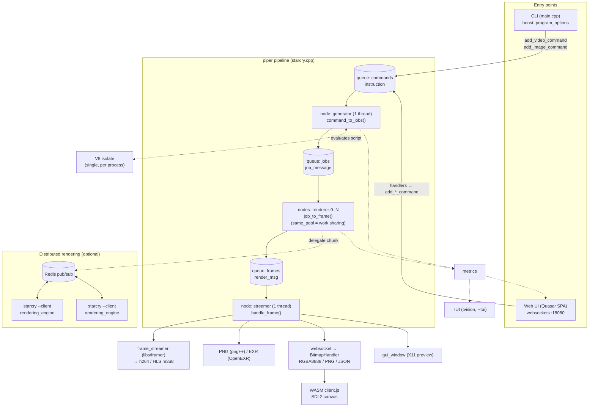

# Starcry — Design & Codebase Summary

> Companion document to [AGENTS.md](AGENTS.md). This file explains *what the code
> is and how it fits together*. AGENTS.md explains *how to work in it*.

---

## 1. What Starcry is

Starcry is a **generative-art rendering engine**: "a blend between Photoshop and
code-based generative art". A project is a **declarative JavaScript file**
(see `input/*.js`) that is evaluated by an embedded **V8** engine. The script
describes gradients, textures, objects, scenes and video settings; the C++ engine
does the heavy lifting of instantiating, animating, rasterizing and encoding.

Two front-ends exist for the same engine:

* **CLI** — `./build/starcry input/foo.js` renders video (h264), PNG/EXR stills,
  or nothing at all (for benchmarking).
* **Web UI** — a Quasar/Vue3 SPA (`web/`) that talks to an embedded Seasocks
  websocket server on port `18080`, with an optional **WebAssembly client**
  (`src/client.cpp` → `web/public/client.js`) that rasterizes shapes in the browser.

There is also a **Turbo Vision TUI** (`src/tvision/`, enabled with `--tui`) that
visualizes per-thread job progress.

Licence: MPL 2.0. Every source file carries the MPL header.

> **Note on `docs/tech_doc.md`:** it is the original (partial) architecture write-up
> and is still worth reading for the memory-usage analysis, but its
> instruction/command table (`get_image`, `get_shapes`, `get_bitmap`, …) predates the
> refactor to `reload_request` / `frame_request` / `video_request`. Where the two
> disagree, this document reflects the current code.

---

## 2. Repository layout

| Path | Contents |
|---|---|
| `src/` | The engine (~23k LOC C++23). See §4 for the breakdown. |
| `src/interpreter/` | The **generator**: V8 ↔ C++ object system, scenes, spawning, physics. Largest and most intricate part (~6.3k LOC). |
| `src/rendering_engine.cpp` / `draw_logic.hpp` | Rasterization of `data::shape` into an `image` (RGBA doubles). |
| `src/data/` | Plain serializable render-side structs (`job`, `shape`, `color`, `gradient`, `texture`, …). |
| `src/data_staging/` | Generator-side *live* object types (`circle`, `ellipse`, `line`, `text`, `script`) composed from mixins (`location`, `movement`, `styling`, `behavior`, `meta`, `generic`, `toroidal`, `cascade`). |
| `src/webserver/` | Seasocks websocket handlers, one per concern. |
| `src/starcry/` | Redis pub/sub server + client (distributed rendering) and `metrics`. |
| `src/tvision/` | Turbo Vision terminal UI. |
| `src/util/` | Logger, V8 wrappers, motion-blur buffers, quadtree, image splitter, random, benchmark, … |
| `src/core/` | Small execution helpers (periodic/limited/delayed executors, fps progress). |
| `src/specs/` | Self-describing field specifications used to generate the JS API docs in the UI. |
| `libs/` | Vendored/submoduled libraries — see §11. |
| `input/` | Example/regression project scripts (`*.js`). Also the corpus for integration tests. |
| `test/` | Catch2 unit tests + image-diff integration tests + `report.py` HTML report. |
| `web/` | Quasar (Vue 3 + Pinia + TypeScript) SPA, Monaco editor, WASM client host. |
| `docs/` | `tech_doc.md`, Doxygen/Sphinx config, helper scripts, Dockerfile for the runtime image. |
| `kube/` | k3s deployment manifests (`make kube`). |
| `cmake/` | `FindV8`, include/link helper modules, clang-format integration. |

---

## 3. Architecture at a glance

Starcry is built on **`libs/piper`**, a small pipeline library: *nodes* connected by
bounded *queues*. A node with only an output is a **producer**, input+output a
**transformer**, input only a **consumer**. Nodes sleep on condition variables when
their input is empty or their output is full, so no CPU is burned on backpressure.



ASCII summary of the same pipeline (handy when mermaid is not rendered):

```
  instruction        job_message          render_msg
  ┌─────────┐  gen   ┌──────┐  renderer   ┌───────┐  streamer  ┌────────┐
  │  cmds   ├───────►│ jobs ├────────────►│frames ├───────────►│ output │
  └────▲────┘  x1    └───▲──┘  xN threads └───────┘    x1      └────────┘
       │                 │                                      h264 / PNG
   CLI │ Web UI          └── optionally offloaded to remote      EXR / WS
                             workers over Redis pub/sub          X11 preview
```

### Queue sizing

`--concurrent-commands`, `--concurrent-jobs`, `--concurrent-frames` (default 22 each)
bound each queue. They are the primary lever against memory blow-up (see §8).

### Fan-out vs. work-sharing

`queue::push()` tags every message with the set of registered consumer ids;
`pop(id)` removes only *that* id. Consequently:

* nodes with **distinct ids** each receive **every** message (broadcast), while
* nodes registered with **the same id** (`transform_type::same_pool`, used by all
  `renderer-*` nodes) **compete** for messages — a worker pool.

---

## 4. The three stages in detail

### 4.1 `starcry` — orchestration (`src/starcry.{h,cpp}`, ~900 LOC)

`starcry` owns the pipeline, the queues, the V8 wrapper, the renderers, the
webserver, the framer and the metrics object. Wiring happens in
`starcry::setup_server()`; `starcry::run()` then blocks on the webserver (interactive)
or joins the pipeline (batch).

Instructions arriving from CLI/UI are turned into commands:

| Instruction | Command class | Origin |
|---|---|---|
| reload script | `reload_instruction` | inotify file watcher, UI |
| render a frame | `frame_instruction` (`data::frame_request`) | `-f N`, UI bitmap/objects/shapes requests |
| render a video | `video_instruction` (`data::video_request`) | default CLI mode |

Dependency injection is done with **boost-ext::di** in `main.cpp`, which constructs
`starcry` with its `starcry_options`, the shared `v8_wrapper` and an optional
`Benchmark`.

**Important V8 constraint:** V8 can only be fully initialized **once per process**.
A single `std::shared_ptr<v8_wrapper>` is therefore threaded through everything, and
the generator node calls `context->recreate_isolate_in_this_thread()` before first use.

### 4.2 `generator` — script → job (`src/generator.{h,cpp}` + `src/interpreter/`)

The generator is **single-threaded** and tightly coupled to V8. Input is kept as
declarative as possible so that the bulk of the work stays in C++.

`generator::generate_frame()` (via `frame_sampler::sample`) calls `_generate_frame()`,
which runs an adaptive loop:

```
for attempt in 1..2:
    stepper.reset()                        # sub-frame ("step") count
    while max_dist_found > tolerated_granularity and not frozen:
        for each step in stepper:
            scenes.prepare_scene(instantiator)      # spawn scene objects
            object_lookup.update()                  # uid -> live object ref
            positioner.update_object_positions()    # velocity + time() callback
            positioner.update_rotations()           # rotate + absolute x,y
            interactor.update_interactions()        # toroidal, collisions, gravity, dedupe
            update_object_distances(...)            # how far did anything move?
            insert_newly_created_objects()
            job_to_shape_mapper.convert_objects_to_render_job(...)   # -> data::shape
            scenes.commit_scene_shapes_intermediates()
            scalesettings.update()
        if moved too far: revert_all_changes(); increase step count; retry
```

**Three object buckets** (held by `scenes`, all `transaction`s with
`commit()`/`revert()`/`reset()`):

* `instances` — current frame
* `instances_next` — next frame
* `instances_intermediate` — state while walking sub-frames

The third bucket exists because one video frame (40 ms at 25 fps) may be split into
N sub-frames for motion blur; if objects turn out to have moved too far, everything
must be revertible so the frame can be re-generated at finer granularity.

**Interpreter components** (each a focused class, injected into `generator`):

| Class | Responsibility |
|---|---|
| `initializer` | Loads the script, video/preview meta, gradients, textures, seeds. |
| `scenes` | Scene list, the three instance buckets, scene switching, commit/revert. |
| `instantiator` | Turns scene/spawn definitions into live `data_staging` objects + V8 bookkeeping. |
| `spawner` | The `this.spawn(...)` family exposed to scripts (incl. line endpoints, parent-relative). |
| `positioner` | Applies `time()` callbacks, velocity, rotation, absolute positioning. |
| `interactor` | Toroidal wrapping, collisions, gravity, unique-group de-duplication. |
| `object_lookup` | `unique_id` → live object reference; also the V8 object for an id. |
| `object_definitions` | The prototype definitions from the script's `objects` map. |
| `bridges` / `object_bridge<T>` | The V8 ↔ C++ property bridge (see below). |
| `gradient_manager`, `texture_manager`, `toroidal_manager` | Named resource registries. |
| `job_to_shape_mapper` | Flattens live objects into `data::shape` entries on `data::job`. |
| `job_holder` | Owns the single `data::job` being built. |
| `frame_sampler` | Frame include/exclude sampling. |
| `checkpoints` | Optional caching of scene/job state so `--frame N` can jump ahead. |
| `fast_forwarder` | Skips (or restores from checkpoint) frames before the frame of interest. |
| `project_specifications` | Self-describing field metadata → JS API docs in the UI. |

**The bridge-object memory trick:** objects used to exist twice (C++ *and* a JS
object each). Now there is exactly **one** V8 bridge instance per *type*
(`object_bridge<circle>`, `object_bridge<line>`, …). To run a script callback for a
given object, the C++ object is pushed onto the bridge's stack, the JS function is
invoked, and every property get/set on the JS side is forwarded straight to the C++
object. This keeps V8 heap usage roughly flat (~1–2 GB) regardless of object count.

### 4.3 `rendering_engine` — job → pixels (`src/rendering_engine.{h,cpp}`, `draw_logic.hpp`)

`rendering_engine::render(render_params&, offset_x, offset_y, width, height)` walks
`job.shapes` (a `vector<vector<data::shape>>` — one inner vector per sub-frame/pass)
and rasterizes into an `image` of `data::color` (four doubles per pixel).

* **Motion blur** is achieved by rendering each sub-frame pass and accumulating via
  `motionblur_buffer*.hpp` (`unordered_map`-based and flat-array variants).
* **Blending modes** live in `color_blender.hpp` (Photoshop-style: normal, add,
  multiply, …; `data/blending_type.hpp`).
* **Textures** are Perlin/noise based (`libs/perlin_noise`, `util/noise_mappers`,
  Zernike polynomials via `data/zernike_type.hpp`).
* **Text** is rendered with `stb_truetype` (`util/text_drawer.hpp`).
* **Debug overlays** (`--debug`) come from `rendering_engine/debug.cpp`.

The same `rendering_engine.cpp` is `#include`d by `src/client.cpp` and compiled to
**WebAssembly**, so the browser renders pixel-identical output from the same code.

### 4.4 `streamer` — pixels → output (`starcry::handle_frame`)

Frames may arrive out of order and in chunks. `handle_frame` buffers them in
`buffered_frames` keyed by frame number, and only emits a frame once **all
`num_chunks` chunks** have arrived. Videos are emitted strictly in order
(`current_frame++`); single stills use a sentinel `uint32_t::max()` key.

Outputs: `frame_streamer` (libs/framer → ffmpeg/x264 h264 or HLS), PNG via `png++`,
32-bit EXR via OpenEXR, the X11 `gui_window` preview, and/or websocket delivery.

---

## 5. Chunking and parallelism

Two orthogonal knobs:

* `-t / --num_threads N` — N `renderer-*` nodes, each taking whole jobs from the
  `jobs` queue. Different frames render concurrently.
* `-c / --num_chunks N` — `util::ImageSplitter` cuts the canvas into N horizontal
  strips and `interpreter::job_mapper` produces one `data::job` per strip. **Each
  chunk carries a full copy of all shapes**, so high chunk counts are expensive in
  memory (see §8).

`--single` forces everything to 1 (threads, chunks, queues, ffmpeg threads) — the
canonical setting for reproducible debugging.

---

## 6. Distributed rendering

`--server tcp://host:6379` starts `redis_server`, `--client tcp://host:6379` starts
`redis_client`. Jobs are serialized (cereal / zpp_bits) and published over Redis
pub/sub; workers run a bare `rendering_engine` and publish frames back.
`redis_server` tracks `outstanding_jobs2` (dispatched, awaiting confirmation) and
`outstanding_jobs3` (confirmed, in progress) with a timeout thread for re-dispatch.

Redis needs a raised pubsub buffer limit:

```
redis-cli config set client-output-buffer-limit "pubsub 512mb 256mb 120"
```

---

## 7. Web UI & websocket protocol

Server: Seasocks on **:18080**, serving `web/dist/spa` plus five websocket endpoints.

| Endpoint | Handler | Request | Response |
|---|---|---|---|
| `/bitmap` | `BitmapHandler` | `{filename, frame}` + viewpoint | raw `RGBA8888` binary |
| `/script` | `ScriptHandler` | `open foo.js`, `list` | file contents / JSON file list; also pushes log lines |
| `/objects` | `ObjectsHandler` | `"foo.js 1"` | JSON of all objects (+ shapes for the WASM client) |
| `/stats` | `StatsHandler` | — | server-pushed pipeline stats & metrics |
| `/viewpoint` | `ViewPointHandler` | `{operation: set\|get, …}` | `data::viewpoint` JSON |

Front-end (`web/src/`): Quasar + Vue 3 + Pinia. Stores under `stores/` mirror the
endpoints (`bitmap`, `objects`, `script`, `stats`, `viewpoint`, `files`, `project`,
`global`); thin websocket wrappers live in `components/endpoints/`; `core/api.ts`
is the shared `StarcryAPI` websocket client (binary / json / text modes).
`MonacoEditor.vue` provides the script editor (with vim & emacs keymaps).

The engine also watches the loaded `.js` file with **inotify-cpp** and pushes a
reload instruction when it changes on disk.

---

## 8. Memory model (the part that bites)

Numbers from `docs/tech_doc.md`, still representative:

* A `data_staging` object is a `std::variant`, so **every** object costs ≥ ~700 bytes.
  100k objects ≈ 70 MB… but there are **three buckets** → ×3.
* 30 sub-frames of motion blur → ×30 → ~9 GB.
* 16 chunks each copying all shapes → ×16 → ~144 GB. **Do not combine many chunks
  with many objects.**
* Bitmaps are 4 doubles/pixel: a 1920×1080 frame is ~8 MB; 30 motion-blur layers
  ~240 MB.

Mitigations built in:

* When sub-frames are used *and* only one chunk is requested, the renderer
  automatically splits the bitmap into `num_sub_frames` regions and renders them
  sequentially, clearing the blur buffers between regions (slower, far less memory).
* `render_msg::suspend()/unsuspend()` can spill a frame's buffers to
  `/tmp/render_msg_buffer-<uuid>` under pressure.
* Shrink `--concurrent-jobs` / `--concurrent-frames`, or use `-t 1 -c 16` for very
  large canvases.

---

## 9. Script (project file) model

A project file assigns a global `script` object:

```javascript
script = {
  gradients: { red: [{position: 0, r: 1, g: 0, b: 0, a: 1}, …] },
  textures:  { … },
  objects:   {
    obj0: {
      type: 'circle',            // circle | ellipse | line | text | script
      x: 0, y: 0, radius: 100, radiussize: 10, hue: 180,
      gradients: [[1.0, 'red']],
      blending_type: blending_type.normal,
      props: { maxradius: 250 },
      init: function()            { this.spawn({id: 'obj1', x: -300, y: 0, z: 0}); },
      time: function(t, elapsed, scene) { this.radius += 100 * elapsed; },
    },
  },
  video:   { fps: 25, width: 1920, height: 1080, scale: 1.0, rand_seed: 5,
             granularity: 1, minimize_steps_per_object: false,
             bg_color: {r:0,g:0,b:0,a:1}, grain_for_opacity: false },
  preview: { width: 512, height: 512 },     // overrides for --preview
  scenes:  [ {name: 'scene1', duration: 3.0, objects: [{id: 'obj0', x: 5, y: 0, z: 0}]} ],
}
```

* `init()` runs once when the object is instantiated; `time(t, elapsed, scene)` runs
  every sub-frame with `t` normalized within the scene.
* Objects are hierarchical: `spawn()` creates children that inherit/cascade
  properties (`data_staging/cascade.hpp`), and `level` tracks nesting depth.
* `scripts` objects import another project file as a sub-tree.
* Helper maths (`expf`, `logn`, noise functions, `blending_type` enum) are injected
  into the JS context by the interpreter.
* `input/*.js` is both the example corpus and the integration-test corpus.

---

## 10. Data model reference

| Type | Where | Notes |
|---|---|---|
| `data::job` | `src/data/job.hpp` | One render unit: canvas/chunk geometry, frame & job number, `shapes[pass][i]`, scales, background, output flags. cereal-serializable. |
| `data::shape` | `src/data/shape.hpp` | Flat render-side struct, **52 members** (the `zpp::bits::members<52>` cap — C++26 is needed for more). Add new fields next to the `@add_field@` markers **and** in `serialize()`. |
| `data_staging::shape_t` | `src/data_staging/shape.hpp` | `std::variant<monostate, circle, ellipse, line, text, script>`; use `meta_visit` / `meta_callback` to dispatch. |
| `instruction` / `job_message` / `render_msg` | `src/messages.hpp` | The three message types flowing through the pipeline. |
| `data::viewpoint` | `src/data/viewpoint.hpp` | UI camera/canvas override (offset, scale, raw/preview flags). |
| `data::settings` | `src/data/settings.hpp` | Per-project render settings (motion blur, grain, …). |

Grep for **`@add_field@`** — it marks every place that must be touched when adding
a shape property. Currently 10 files: `data/shape.hpp` (field + `serialize()`),
`interpreter/object_bridge.{h,cpp}` and the five `object_bridge_<type>.cpp`
registrations, `interpreter/instantiator.cpp`, `interpreter/job_to_shape_mapper.cpp`.
If the property is also script-facing, declare it in `src/specs/video.hpp`
(`create_object_spec` / `create_video_spec`) so it gets type-validated and shows up
in the UI's JS API documentation.

---

## 11. Dependencies

**Vendored in `libs/`** (git submodules; `git clone --recursive`):
`piper` (pipeline), `framer` (ffmpeg wrapper), `perlin_noise`, `v8pp`, `cereal`,
`json` (nlohmann), `zpp_bits`, `stb`, `Catch2`, `boost` (the `boost-ext::di` header).

**Built as `cppse-*` .deb packages** in the sibling repo `../build-config/`,
installed into the build image at **`/opt/cppse/build/<name>/`**:
`v8`, `boost`, `ffmpeg` + `x264`, `seasocks`, `fmt`, `png++`, `openexr`, `tvision`,
`inotify-cpp`, `redis-plus-plus` + `hiredis`, `vivid` (colour), `fastpfor`
(compression), `allegro5`, `sfml`, `imagemagick`, `opentelemetry-cpp`, `caf`.

Include paths live in `cmake/StarcryIncludes.cmake`; link lines in
`cmake/StarcryLinking.cmake`. **Everything is statically linked** — the resulting
binary is relatively portable.

---

## 12. Build & run

All builds go through the container image
`docker.io/rayburgemeestre/build-starcry-ubuntu:26.04` (podman is preferred when
present); the `Makefile` transparently runs locally if already inside the container.

| Command | Result |
|---|---|
| `make` | list all targets |
| `make build` | clang build → `build/starcry` |
| `make build-gcc` | gcc build |
| `make debug` | `-O0 -g` clang build |
| `make debug-sanitizer` | ASan build |
| `make test` | Catch2 unit tests (`build/unit_tests`) |
| `make integration-test` | image-diff tests + `test/report.py` HTML report |
| `make client` | emscripten → `web/public/client.js` + `.wasm` |
| `make build-web` | Quasar SPA → `web/dist/spa` |
| `make run-web` | `quasar dev` hot reload |
| `make format` | clang-format-19 (C++ **and** `input/*.js`) + prettier for `web/` |
| `make dockerize` / `make push` / `make kube` | runtime image → Docker Hub → k3s |

CMake targets: `starcry` (main binary), `sc_client` (desktop SDL2 build of the WASM
client), `unit_tests`, `integration_tests`. C++23, `-DV8_COMPRESS_POINTERS
-DV8_ENABLE_SANDBOX`, ccache and mold/gold where available.

Useful runtime flags:

```
starcry input/blank.js                       # h264 video (single-threaded sequencing)
starcry input/blank.js -f 100                # frame 100 → PNG + EXR
starcry input/blank.js --raw --no-video      # raw EXR frames, best parallelism
starcry input/blank.js --no-video            # bench generation + rendering
starcry input/blank.js --no-video --no-render# bench frame generation only
starcry input/web.js -t 1 -c 16              # huge canvas, low memory
starcry input/test.js --gui                  # X11 preview (ctrl+t toggles)
starcry input/test.js --tui                  # Turbo Vision terminal UI
starcry --benchmark …                        # writes input/RESULT_<name>.TXT
```

---

## 13. Testing

* **Unit tests** — `test/test_unit.cpp` plus `color_test.cpp`, `gradient_test.cpp`,
  `imagesplitter_test.cpp` (Catch2).
* **Integration tests** — `test/test_integration.cpp` drives the whole engine through
  `test/system_under_test.hpp` (`sut`), renders known scripts and **compares images
  against reference PNGs** with a per-test fuzziness tolerance. References come from
  `make download-integration-test-reference` (`reference.tar.gz` from cppse.nl) and
  land in `test/integration/`. `test/report.py` builds `test/report.html`.
* Tests are run with `--rng-seed 0`; several cases are documented as flaky/
  non-deterministic (blur video is disabled, blending/kaleidoscope have tolerances).

---

## 14. Known rough edges (from README / tech_doc TODOs)

* V8 code is still scattered rather than confined to mappers; the goal is a proper
  JS ↔ shape mapper layer.
* The legacy `props` system on shapes is slated for removal.
* `add_image_command` overloads are unclear about which instruction maps where.
* `data::shape` is at the 52-member `zpp::bits` ceiling and wants refactoring.
* Chunking should auto-downgrade to `-c 1` when the object count makes copies
  prohibitive.
* Several websocket endpoints use ad-hoc text protocols where JSON would be better.
